  

<h1 align="center">Frozio</h1>

spoti.pw's features and Liquid Glass design, rebuilt for <b>NaviMus / Arpeggi</b> (Subsonic / Navidrome client).

---

> **Status: Phase 1.** This is a no-op tweak plus the build, inject and sign pipeline. Frozio doesn't change anything in the app yet.

## What it is

- A Theos tweak injected into a sideloaded **NaviMus 1.6.1 (build 173)** IPA.
- It targets spoti.pw's **redesign** look (iOS 26 Liquid Glass, with material fallbacks on iOS 17–25), with every feature ungated.
- It's version-locked: on any other NaviMus build, Frozio installs nothing.

See `docs/PHASE0_REPORT.md`, `docs/FEATURE_MATRIX.md` and `docs/DESIGN_TOKENS.md`.

## Building an IPA

The **Build, inject, sign and release Frozio** workflow (Actions → Run workflow) needs these repository secrets:

| Secret | Content |
|---|---|
| `BUILD_CERTIFICATE_BASE64` | Your Apple Development/Distribution certificate as a base64 `.p12` |
| `P12_PASSWORD` | The `.p12` password |
| `PROVISIONING_PROFILE_BASE64` | A base64 `.mobileprovision` for `com.reillywilkinson.NaviMus` (or a wildcard App ID) |
| `TEAM_ID` | Your 10-character Team ID (must match the profile) |
| `KEYCHAIN_PASSWORD` | Any random string (temporary CI keychain) |

The IPA comes from one of two places (it is never committed):
- **Either** `ipa_url`, a direct download URL,
- **or** an asset uploaded to a **draft** release named `ipa-source` in this repo (drafts are visible only to you).

The signed IPA is attached to a **draft** release `Frozio build <n>`.

## App icons

Cyan is the default icon. White is an alternate icon you'll be able to pick in Frozio settings.

## License

GPL-3.0. See `docs/LICENSES.md` for what code is borrowed and from where.
